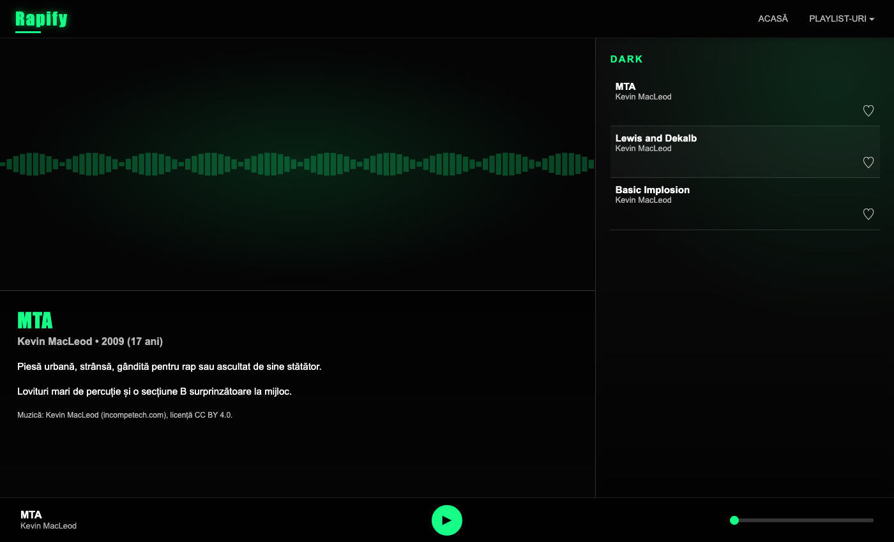
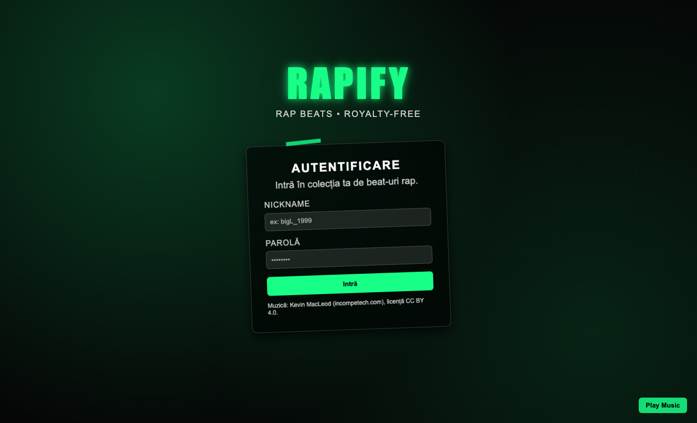

# Rapify

A Spotify-inspired web player for rap beats, built with **vanilla HTML, CSS and JavaScript** (no frameworks) as a project for the *Web Technologies* course, Faculty of Mathematics and Computer Science, University of Bucharest.



## Features

- **Audio player** with play/pause (button or <kbd>Space</kbd>), seekable timeline and per-track info panel
- **Real-time audio visualizer** built with the Web Audio API (`AnalyserNode`, FFT) and HTML5 Canvas
- **Playlists by mood** (Boom Bap, Dark, Chill) with a dropdown navigation menu
- **Login page** with regex-based username validation; the session and **favorites** are persisted in `localStorage`
- Responsive layout with CSS Grid and Flexbox



## Running locally

Serve the folder with any static server (the Web Audio visualizer needs `http://`, not `file://`):

```bash
python3 -m http.server 8000
# open http://localhost:8000/auth.html
```

## Structure

| File | Purpose |
| --- | --- |
| `auth.html`, `auth.css`, `auth.js` | Login page and validation |
| `index.html` | Home page with all tracks |
| `BoomBap.html`, `Dark.html`, `Chill.html` | Playlists |
| `audio/` | Music files |
| `index.css` | Shared styles for the player pages |
| `app.js` | Player logic, visualizer, favorites |

## Music credits

All tracks by **Kevin MacLeod** ([incompetech.com](https://incompetech.com)), licensed under [Creative Commons: By Attribution 4.0](https://creativecommons.org/licenses/by/4.0/):
Griphop, Got Funk, Vicious, MTA, Lewis and Dekalb, Basic Implosion, Chillin Hard, Slow Jam, Galactic Rap.
